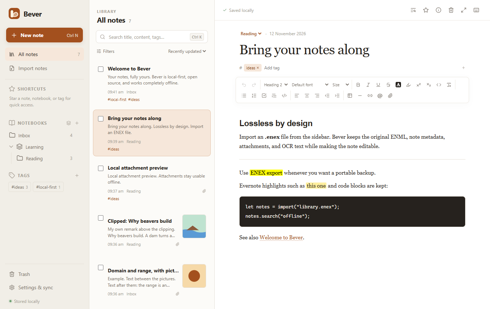
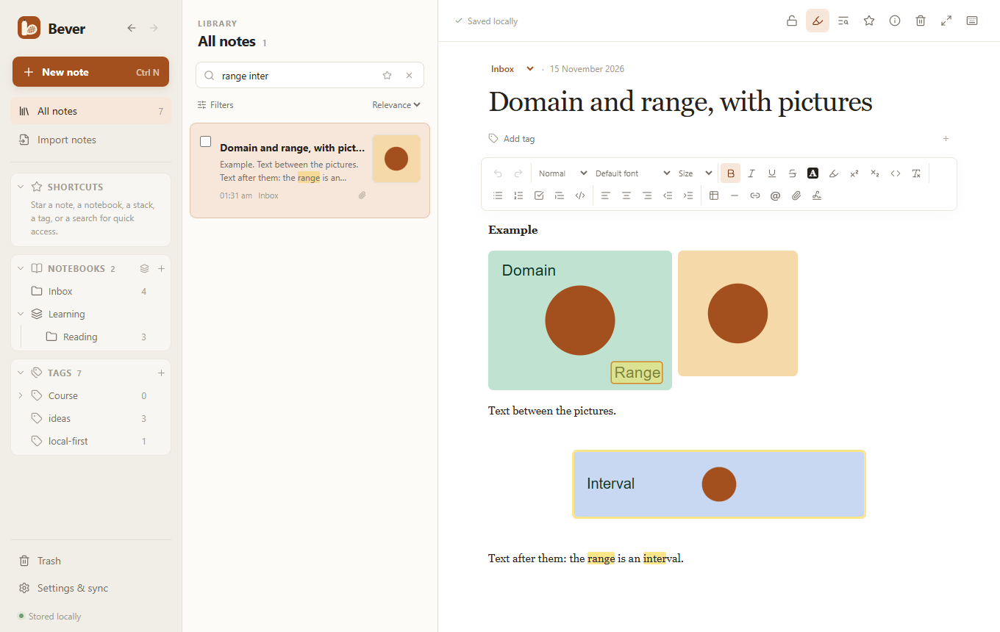
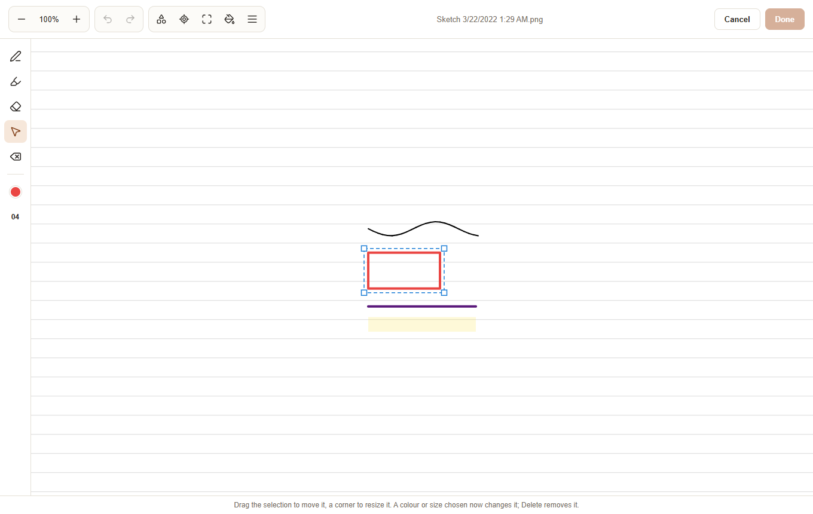
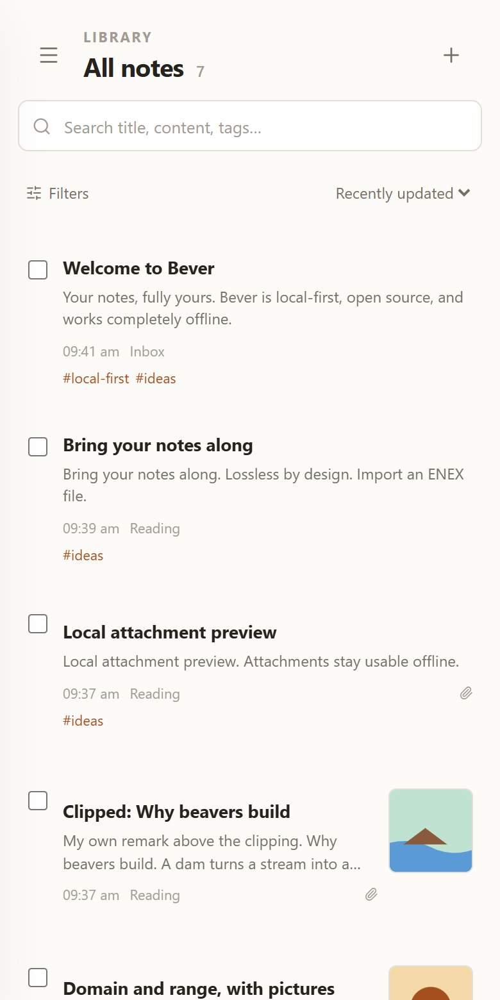

<p align="center"></p>

# Bever

Bever is a free, open-source, local-first note application. Notes, attachments, metadata, and the full-text search index live on your device, and there is no application server. It reads and writes the ENEX format, so a library kept in Evernote can be brought along. Optional pCloud synchronization is started by you and uses your own storage.

It runs on Windows and Android today. Changes are listed in the [changelog](CHANGELOG.md).

Bever is an independent project. It is not affiliated with, endorsed by, or sponsored by Evernote or pCloud; see [Trademarks and other software](#trademarks-and-other-software).



| What a search found, in text and in pictures                                                                      | A sketch, stroke by stroke                                              | On a phone                                                  |
| ----------------------------------------------------------------------------------------------------------------- | ----------------------------------------------------------------------- | ----------------------------------------------------------- |
|  |  |  |

## What is implemented

**Library**

- Notes, notebooks, notebook stacks, tags, shortcuts, and a trash that can be restored from or emptied.
- Create, rename, and delete notebooks, stacks, and tags. Deleting a notebook moves its notes to the trash.
- Move, copy, tag, untag, trash, restore, delete, and export several notes at once.
- Shortcuts to notes, notebooks, stacks, tags, and searches; note counts in the sidebar.
- In the sidebar the shortcuts, the notebooks, and the tags are three boxes, each of which folds away and says how many it holds; what is in a stack or in a tag stands further in, under its name.
- Back and forward among the notes and the lists you have been at, as in a browser: the arrows beside the name, Alt+Left and Alt+Right, or the side buttons of a mouse.
- The order you choose for the list of notes, and for the notebooks and the tags on their screens, is remembered on the device.
- The list of notes shows each note by its largest picture, by the one you choose from a picture's menu (**Use as note thumbnail**), or by none: the thumbnail is taken away, and brought back, in the note's information.
- A note is pinned to the top of its notebook from its header, from its information, or for several notes at once from the list. The one pinned last stands first.
- Tags nest inside tags, as deep as you like, and a notebook belongs to a stack; both are shown as they are, and names are listed with their numbers read as numbers (`note-2` before `note-10`).
- **Notebooks** and **Tags** each have a screen of their own, reached from their heading in the sidebar: find one by name, see how many notes it has, and rename, move, or delete it.

**Editing**

- Rich text: headings, font family, size and color, bold, italic, underline, strikethrough, highlight, inline code, lists, checklists, alignment, indentation, quotes, code blocks, horizontal lines, subscript and superscript, links, and links between notes.
- Tables inserted at a chosen size, with named row, column, and header tools and columns that can be dragged wider.
- Attachments inserted at the cursor from a file picker, the clipboard, or drag and drop. Images, audio, video, and PDF pages are shown in the note; any attachment can be opened in another application or saved to a file.
- Pictures at the size and alignment Evernote recorded; a selected picture can be dragged to any width, aligned left, centre, or right, or made to fill the width.
- Sketches are begun from a note's toolbar, and those drawn in Evernote open stroke by stroke: draw with a pen or highlighter, erase, snap hand-drawn shapes, change the paper, and save in the form Evernote reads. A pen that reports its pressure draws thin and thick lines. Selected strokes can be moved, resized by a corner, and given another colour or pen size.
- Annotations on pictures: arrows, shapes, text, stamps, pen, and highlighter. Annotations made in Evernote open as separate marks that can be moved, reworded, and removed, and new ones are stored the same way.
- A note can be expanded to the whole window (Ctrl+\\), putting the notebooks and the list of notes away.
- A note is made larger to look at with two fingers spread on it, or with Ctrl and the wheel, as a page of a PDF is: its lines stay as they are, and what does not fit is reached by moving the note.
- A PDF opens over the window as its pages one under another, to scroll through. Two fingers, Ctrl with the wheel, a double tap or click, or the buttons make it larger and smaller about the place looked at, up to eight times the width of the view, and a page made larger is drawn again at its new size, as sharp as before. One finger, or the mouse held down, moves it.
- Going back (Android's Back, a mouse's button for it) closes what was opened last, one thing for one step: a menu, a dialog, a panel, a preview, the editor of a picture, the drawer, the note; with nothing open it leaves the application.
- A note is stored anew only when it was changed. Placing and moving the cursor, a letter typed and taken away again, or a keyboard that takes up a word and puts it back leave the note as it is, to its date.
- Automatic saving. If a note changes underneath an open editor, your version is kept beside it as a conflict copy.
- A guard against changing a note by mistake: the padlock makes a note read-only; **Discard changes** puts it back as it was when you opened it; and the last five earlier versions of a note are kept on the device, under **Note information**, to be put back. Notes can be made to open read-only.
- A click on a link while writing offers to open, edit, copy, or remove it; Ctrl+click opens it at once.
- Editable created and updated dates, source URL, and author.

**Evernote compatibility**

- ENEX import of several files at once, each into a notebook you choose, with progress, cancellation, and a summary of anything skipped.
- ENEX export of notes, selections, and notebooks.
- Original ENML, metadata, attachments, alternate resource data, and recognition text are kept. A note that has not been edited is exported with the ENML it was imported with.
- Checklists, highlights, code blocks, encrypted blocks, and links between notes are understood.
- Web clippings, and laid-out HTML pasted into a note such as rendered mathematics, are shown with their own layout and can be made editable.
- Importing the same file twice does not create duplicates.
- Importing from the Evernote application on the same computer also brings its stacks, the nesting of its tags, and its shortcuts, and gives a note that has no title the one Evernote shows for it.
- Evernote's tasks come as checklists in their notes, with when each is due.
- An import ends by saying what it left in Evernote: notes in its trash, shortcuts that lead nowhere, attachments Evernote itself has lost.

**Search**

- Offline full-text search over titles, text, tags, notebooks, attachment names, and text recognised in images. What was found is ordered by where the words are: in the title first, then in the notebook's name, then in the tags, then in the text; and within each, notes that have the words in the order typed and close together come first (“my apple” before “my friend's apple” before “apple of my eye”). The passage that answers the search is shown. A search that finds nothing as typed is made again with the words of the library that are spelt nearly so (a letter missing, too many, or wrong, or two letters swapped), and says which it took.
- A note opened from a search shows what the search found: in its text, and in its pictures, where the words are marked in their places. The marks can be switched off in the note's header.
- Find in a note (Ctrl+F, or the button in the note's header) steps through its text and the text recognised in its pictures.
- Evernote-style operators and a filter panel for tags, dates, and content types. The panel offers the tags of the notes listed, each with the number of those notes that have it, and finds a tag as its name is typed; the other tags are there when asked for.

**Synchronization and privacy**

- Optional pCloud synchronization with revisions, conflict copies, and deletions that reach your other devices.
- Optional on-device text recognition for PNG, JPEG, and WebP images, done in the background.
- No account, telemetry, advertising, AI service, or server-side application compute.

## Technology

- **Shell:** Tauri 2
- **Native core:** Rust, SQLite, `rusqlite`, `quick-xml`
- **UI:** React, TypeScript, TipTap, Zustand
- **Cloud adapter:** pCloud's official HTTPS API; access tokens are kept in the operating system credential vault

The Rust core does not depend on React or Tauri and can be reused by future Linux, macOS, and iOS shells.

## Run locally

Prerequisites:

- Node.js 22 or newer and npm
- Stable Rust with Cargo
- Tauri's [platform prerequisites](https://v2.tauri.app/start/prerequisites/)
- Windows: Microsoft C++ Build Tools and WebView2

```sh
npm ci
npm run tauri -- dev
```

The ordinary web command, `npm run dev`, opens a **non-persistent browser demonstration** with sample notes. Files, ENEX, real attachments, credential storage, and pCloud require the Tauri application.

Useful commands:

```sh
npm test                 # interface and editor unit tests
npm run test:core        # Rust tests, including synchronization round trips
npm run test:ui          # builds the interface and drives it in a browser
npm run test:native      # drives the built Windows application (see below)
npm run test:sync        # synchronizes it with a stand-in for pCloud on this computer
npm run lint             # TypeScript and Rust lint
npm run format:check     # formatting checks
npm run build            # production interface
npm run tauri -- build   # native desktop release and installers
```

`npm run test:native` and `npm run test:sync` start `target/release/bever.exe` with a temporary library, so they never touch the library of an installed Bever, its pCloud sign-in, or pCloud. Build the executable first with `npm run tauri -- build --no-bundle`; the second also needs `cargo build --release -p bever-core --example import_enex`.

### Android

Install JDK 17+, Android SDK, an NDK, and the Rust Android targets. Set `JAVA_HOME`, `ANDROID_HOME`, and `ANDROID_NDK_HOME` for your installation, then run:

```sh
rustup target add aarch64-linux-android armv7-linux-androideabi i686-linux-android x86_64-linux-android
npm run android:init
npm run android:build
```

`android:init` is only needed once. A generated debug APK is for testing, not a signed store release. Device interaction must be verified separately from compilation.

On Windows without symbolic-link privileges, the Tauri CLI can compile the Rust library and then stop before Gradle packaging. Do not enable elevated privileges just for packaging: after the native library has been built, copy it into the generated JNI directory and package that ABI directly. From the repository root (use the equivalent paths in PowerShell):

```sh
mkdir -p src-tauri/gen/android/app/src/main/jniLibs/arm64-v8a
cp target/aarch64-linux-android/release/libbever_lib.so \
  src-tauri/gen/android/app/src/main/jniLibs/arm64-v8a/libbever_lib.so
cd src-tauri/gen/android
./gradlew.bat :app:assembleArm64Debug -x :app:rustBuildArm64Debug
```

The resulting APK is `app/build/outputs/apk/arm64/debug/app-arm64-debug.apk`. The exclusion skips only the already-completed native build/symlink step. It is not a substitute for rebuilding after Rust or frontend changes; run the normal Android build again first so the native library embeds the current frontend.

### Releasing

```sh
npm run release:version -- 1.0.0   # sets the version in every file that records it
npm run tauri -- build             # Windows installers
npm run android:build              # APK
npm run release:package            # release/ with a source archive and SHA256SUMS.txt
```

Every icon is generated from `public/bever.svg`: the desktop icons into `src-tauri/icons`, the Android launcher icons into the Android overlay. Run this after changing the icon:

```sh
node scripts/icons.mjs
```

The pictures in this file and in the Android listing are taken from the browser demonstration by `npm run build && node scripts/screenshots.mjs`. What a store listing needs for Android is in `fastlane/metadata/android`; what is still open for F-Droid is in [Publishing on F-Droid](docs/fdroid.md).

## Importing from Evernote

Choose **Import notes** in the sidebar. There are two ways, and both give the same notes.

**Evernote on this computer** reads your notes straight from the files the Evernote application keeps of them on your computer: every notebook at once, each in its stack, with nothing to export. Evernote has to be installed on the same computer, signed in, and synchronized; nothing is signed in to by Bever, no Evernote service is contacted, nothing is sent anywhere, and Evernote's files are only read. The account's notebooks are listed by stack and any of them can be left out. This is on Windows. A note of which Evernote does not have everything on the computer is named before the import and left out; open that note in Evernote while online and import again, or have it imported without the attachments that are missing. How this works, and how it was checked against exports, is in [Importing from the Evernote application](docs/evernote-local.md).

**ENEX files** takes one or more `.enex` files exported from Evernote. Each file goes into a notebook you can name, or into one you already have; the suggested name is the file name without Evernote's “(171 notes)” suffix.

Either import can be cancelled, and ends with a summary that says what it had to skip.

Importing again brings notes up to date, whichever way they came. A note that has not changed is passed over. A note that has changed in Evernote since takes the place of the one that is here, as the same note in the same notebook, provided you have not changed it here; if you have, both versions are kept, yours and Evernote's. A note deleted in Evernote stays, and a note in the trash here stays in the trash. A note from an export is known again by its title and time of creation, a note from the Evernote application by its identifier, so a note retitled in Evernote is brought up to date only when it comes from the application.

Attachments are streamed from the export into the library, so the memory an import needs does not grow with the size of an attachment. A 921 MiB export imports in about 7 seconds with a peak of 14 MiB on the development machine.

Links between notes are connected after the import. Notes from the Evernote application carry their identifiers, and their links are connected by them. Current Evernote exports do not contain note identifiers, so a link is matched by the title it shows, and only when exactly one note has that title. A link to a note you import later is connected when that note arrives. A link that cannot be matched searches for its text when clicked.

Images that live on other websites are not fetched until you ask for them in the note, or always if you turn on **Settings & sync → Images from the web**.

A page clipped with Evernote's web clipper is shown as it was clipped, as one block in the note that is not edited in place. You can select and copy its text, follow its links, and write above and below it. **Make editable** turns it into ordinary note content, which keeps the text, links, images, lists, and tables but not the page's layout.

The same is done for laid-out HTML that was pasted into a note without being clipped, which Evernote shows as “HTML content”. A formula copied from a web page is the usual case.

Encrypted Evernote `en-crypt` blocks are preserved and displayed as encrypted blocks, but Bever does **not** decrypt them. See [ENEX compatibility](docs/enex.md) for details.

## Search

```text
project roadmap              both words, each matched from its beginning
"exact phrase"
intitle:meeting
tag:receipt  -tag:paid
notebook:Personal  stack:Work
created:2026-01-01..2026-12-31
updated:week                 changed since the start of this week
created:day-1                created since yesterday
resource:image/*
contains:checklist           also images, audio, video, pdf, files, code, tables, links
todo:false                   has an unticked checkbox
any: alpha beta              either word
```

Supported operators are `intitle:`, `tag:`, `notebook:`, `stack:`, `created:`, `updated:`, `resource:`, `contains:`, `source:`, `todo:`, `encryption:`, a leading `-` to exclude, and a leading `any:` to match any term instead of all. An unquoted word also finds words that begin with it; put it in quotes for an exact match. Dates may be written `2026-01-31` or `20260131`, or as `day`, `week`, `month`, or `year` with an optional `-N`. Text containing a colon, such as `10:30`, is searched as written.

Search runs entirely against the local SQLite index.

## Text recognition in images

Text that Evernote already recognised is imported and searchable, with the place of each word in the picture. Bever can also read PNG, JPEG, and WebP images on the device, and keeps the words it finds with their places in the same form, so that a search can mark them in the picture. A picture recognised before that was kept is marked as a whole. This happens in the background after an import, an attachment, or a synchronization; it continues after a restart and can be paused under **Settings & sync → Offline image text recognition**. It is on by default on Windows and off by default on Android, where text recognised on another device still arrives through synchronization. The bundled Ocrs models make no network requests and are best suited to printed Latin-alphabet text.

## Optional pCloud synchronization

1. Create or open a pCloud OAuth application. The bundled public client identifier is for the application details supplied during development; no client secret is included or needed for implicit token flow.
2. Add the redirect URIs `http://127.0.0.1:53682/`, for Windows and other desktops, and `bever://oauth/pcloud`, for Android, then **allow implicit grant (token flow)** and save the pCloud application settings. The application registered for the bundled identifier has both.
3. Open **Settings & sync → Connect with browser**, or use the manual access-token option with the correct Global/Europe API region. A sign-in you have abandoned can be cancelled.
4. Choose **Sync now**. Bever creates `/Bever/items`, `/Bever/blobs`, and `/Bever/metadata.json` in your pCloud account. The current operation, elapsed and network time, request count, and transferred bytes are visible while it runs.

Tokens are kept in the OS credential vault, not the notes database; Android uses Keystore-backed encrypted preferences. The token is sent to pCloud in a request header, never in an address. The remote copy is **not end-to-end encrypted**; pCloud can access the uploaded content.

Synchronization is started by you, never scheduled. One native worker runs app-wide; its progress remains visible outside Settings. Closing the Windows window during a run hides Bever to the tray until the worker finishes, and Android uses a data-sync foreground service with notification progress when permission allows. Background completion is best-effort: force-stop, reboot, OS process termination, Android 14+ data-sync time limits, and OEM battery policies can interrupt it. An interrupted run leaves both sides consistent, and the next run continues from there.

What a run does:

- Notes changed on one side are copied to the other. A note changed on both sides is kept twice: the remote version, and yours as a “conflict copy”.
- A deleted note, notebook, stack, tag, or shortcut is deleted on your other devices. A note you edited since the last run is kept even if another device deleted it.
- Notebooks, stacks, and tags that have the same name on two devices are merged into one.
- Attachments are transferred four at a time, streamed, and verified by SHA-256.

Every device must run the same Bever version. Do not use synchronization as your only backup. See [the synchronization format](docs/sync.md) for the details and limits.

## Uninstalling

An uninstaller removes the program. Your notes are kept, so that installing again finds them. For a clean uninstall, with nothing left on the device:

- **Windows, either installer:** open **Settings** and choose **Remove all data from this device**, then uninstall. It removes the notes and attachments, the pCloud login, and the interface's preferences, and closes Bever. Nothing is changed in pCloud; notes that were never synchronized or exported are gone for good, which is why the word ERASE has to be typed.
- **Windows, `setup.exe` installer:** its uninstaller has a box, **Delete the application data**. Ticked, it removes the same things, and the folders that held them.
- **Windows, MSI installer:** it cannot ask, and leaves the data. Remove the data in Settings first.
- **Android:** uninstalling removes everything. Backup of the application's data to a Google account is switched off, so a reinstall starts empty.

What is where on Windows: the library in `%APPDATA%\io.github.balakrishnangithub.bever`, the WebView's files in `%LOCALAPPDATA%\io.github.balakrishnangithub.bever`, and the pCloud login in Credential Manager as `pcloud.io.github.balakrishnangithub.bever`. After **Remove all data from this device** only the WebView's folder is left, with no notes in it; the `setup.exe` uninstaller removes it when its box is ticked, and it can be deleted by hand.

## Data and portability

The native app stores its SQLite database and attachment blob store in the operating system's application-data directory for `io.github.balakrishnangithub.bever`. Keep ENEX exports or a separate backup of that directory. Content hashes are verified during attachment import and download. Deleting notes for good removes attachment files that no other note uses.

## Verification

Automated tests cover the following. None of them needs a network connection or an account.

- **Rust core:** ENEX reading and writing (entities, CDATA, nested elements, damaged attachments, streamed attachment hashes), ENML conversion in both directions, links between notes, duplicate detection, search ranking, operators and dates, library management with deletion records, attachment storage and cleanup, background text recognition, and synchronization round trips between two libraries through an in-memory remote: push, pull, conflict copies, deletions, name merges, interrupted runs, a device joining while another is still uploading, and retries.
- **Native shell:** attachment file names, byte ranges for media, link schemes, OAuth callbacks, and the worker's state.
- **Interface:** saving drafts, stale responses, editor parsing and serialization, web clippings and what is removed from them, search snippets, and import progress.
- **Browser check:** dialogs, menus, bulk actions, filters, the tags of a listing among six hundred and swipes on them from emulated fingers, a PDF of forty pages scrolled through and made larger by wheel, mouse and two fingers, going back out of everything that opens, the filter and the PDF preview in windows from a small phone to a large monitor, paging, tables, links, pictures and their annotations, sketches, web clippings and HTML content, the screens of notebooks and of tags, a list of 1,500 notes with its scroll bar, the expanded note, search marks and find in text and pictures, note thumbnails, importing from the Evernote application, removing all data, and mobile navigation in light and dark themes; it also fails if anything is requested from the web.

Before a release these are also checked on Windows:

- Private exports (of 2 to 705 notes and up to 922 MiB) are imported, exported, and imported again; note text, metadata, tags, and attachment hashes must match. The files are not added to source control.
- Temporary libraries are synchronized through a real pCloud account in a folder made for the test, including a run that is cut off halfway and joined by a second device.
- The built Windows application is driven through its own window, with an empty library and with an imported one.

The Android build is compiled and packaged for each release. Its file pickers, opening of attachments, and keyboard handling have not been run on a device as part of these checks.

`test-results/` and `test-data/` hold local-only test artifacts and are ignored by Git.

## Project documentation

- [Changelog](CHANGELOG.md)
- [Architecture](docs/architecture.md)
- [ENEX and ENML compatibility](docs/enex.md)
- [Importing from the Evernote application](docs/evernote-local.md)
- [Synchronization format and limitations](docs/sync.md)
- [Publishing on F-Droid](docs/fdroid.md)
- [Contributing](CONTRIBUTING.md)
- [Security policy](SECURITY.md)

## Trademarks and other software

Bever is an independent, non-commercial open-source project. It is not affiliated with, endorsed by, sponsored by, or connected to Evernote Corporation, Bending Spoons, or pCloud AG.

“Evernote” and “Skitch” are trademarks of their owner, and “pCloud” is a trademark of pCloud AG. They are named here only to say what Bever can read, write, and connect to. Bever's name, icon, and appearance are its own, and none of Evernote's logos, artwork, or program code is part of it.

Reading Evernote's files is done for interoperability: so that people can take the notes they wrote to another program. ENEX is the export format Evernote documents and offers for that purpose. The import from the Evernote application reads, on your own computer, the copy of your own notes that the application keeps there; it does not sign in to Evernote, use its service or its keys, or get around any protection, and it changes nothing. How the files are read was worked out by looking at such files, not at Evernote's program. Whether you may use it is between you and the terms you accepted from Evernote; if in doubt, use the ENEX export.

## License

GPL-3.0-or-later; see [LICENSE](LICENSE). The bundled text-recognition models have their own licence, given in [crates/bever-core/models/README.md](crates/bever-core/models/README.md).
